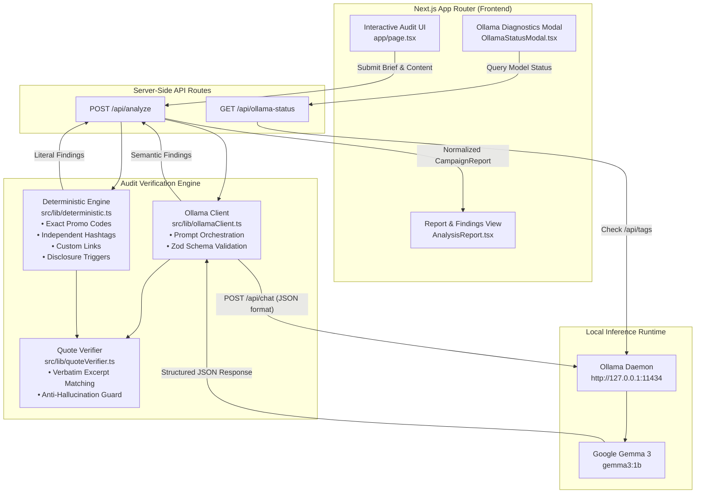

<div align="center">

# SponsorProof

**Catch campaign mistakes before submitting sponsored content.**

An evidence-based compliance auditor for content creators and video editors. SponsorProof compares brand briefs with draft scripts, transcripts, or captions to catch missed requirements, verify exact discount codes and hashtags, quote supporting source evidence, and suggest copy-paste corrections.

Powered by a hybrid verification engine combining deterministic rule-based checks with local **Google Gemma 3** inference via **Ollama**.

---

[](https://nextjs.org/)
[](https://react.dev/)
[](https://www.typescriptlang.org/)
[](https://tailwindcss.com/)
[](https://ai.google.dev/gemma)
[](https://ollama.com/)
[](file:///c:/Users/ARCHIT%20SINGHAL/sponsorproof/tests)

</div>

---

## Table of Contents

- [Overview](#overview)
- [The Problem](#the-problem)
- [Key Features](#key-features)
- [How It Works](#how-it-works)
- [Architecture](#architecture)
- [Tech Stack](#tech-stack)
- [Installation and Setup](#installation-and-setup)
- [Example Demonstration](#example-demonstration)
- [Privacy and Open Innovation](#privacy-and-open-innovation)
- [Limitations](#limitations)
- [Testing](#testing)
- [Project Structure](#project-structure)
- [Roadmap](#roadmap)
- [Contributing](#contributing)
- [License](#license)
- [Acknowledgements](#acknowledgements)

---

## Overview

**SponsorProof** helps creators, video editors, and agency managers audit sponsored content scripts, captions, and transcripts against contractual brand briefs prior to filming or publishing.

Instead of relying on guesswork or generic chatbots that hallucinate compliance, SponsorProof employs a **hybrid audit pipeline**:
1. **Deterministic Code Checks:** Validate exact literal elements like coupon codes, required hashtags, vanity URLs, and disclosure trigger phrases.
2. **Local AI Semantic Checks:** Run **Google Gemma 3** (configured by default as `gemma3:1b` via local **Ollama**) to interpret complex brand guidelines, mandatory talking points, prohibited claims, and tone.
3. **Strict Quote Verification:** Every finding is linked to verbatim text excerpts from both the brand brief and creator draft, ensuring conclusions are verifiable and defensible.

<!-- Add screenshot here: docs/screenshots/audit_dashboard.png -->

---

## The Problem

Sponsored integrations and brand partnerships require compliance with strict contractual deliverables. Creators frequently face avoidable revision rounds and delayed approvals due to simple oversights:

- **Mismatched Promo Codes:** Case sensitivity errors or typos (e.g., submitting `STYLE10` instead of `STYLE15`) break attribution tracking.
- **Omitted Hashtags:** Contracts often mandate multiple tags (e.g., `#NordPartner`, `#onlineprivacy`, `#ad`). Matching one tag does not satisfy the contract if others are omitted.
- **Missing Sponsorship Disclosures:** Regulatory guidelines (FTC, ASA, CMA) and platform rules require prominent commercial disclosure.
- **Missing or Generic Calls to Action:** Failing to direct viewers to the sponsor link or specific discount.
- **Overlooked Mandatory Talking Points:** Forgetting to mention specific product features, trial guarantees, or platform specs.
- **Pacing and Timing Discrepancies:** A 60-second sponsored segment scripted at only 30 seconds of spoken dialogue.

These mistakes trigger friction between brands, agencies, and creators. SponsorProof catches these discrepancies during the drafting stage.

---

## Key Features

- **Hybrid Dual-Engine Audit:**
  - **Exact Text Match:** Deterministic regex algorithms for case-sensitive promo codes, boundary-aware hashtag matching, and custom sponsor URLs.
  - **AI Semantic Check:** Local Gemma 3 model evaluates semantic talking points, benefit claims, and context.
  - **Calculated Check:** Automated spoken duration and pacing analysis based on word counts (~140 wpm standard cadence).
- **Independent Hashtag Verification:**
  - Evaluates each required hashtag individually with word boundary regex (`(?:^|[^a-zA-Z0-9_])(#tag)(?![a-zA-Z0-9_])`).
  - Flagging `#NordPartner` as present will not falsely pass missing tags like `#onlineprivacy` or `#ad`.
- **Verifiable Evidence & Anti-Hallucination Guard:**
  - Locates and highlights verbatim quotations from both the brief and draft script, including character offset locations.
  - If the AI flags an item as compliant (`PASS`) but cannot verify verbatim evidence in the draft, the finding is automatically downgraded to `NEEDS_REVIEW`.
- **Full-Sentence Call-to-Action Quoting:**
  - Extracts the full context of the creator's call to action rather than isolated keywords like `"link"`.
- **Clear Disclosure Assistance:**
  - Detects recognized commercial sponsorship disclosures (e.g., `#ad`, `#sponsored`, `sponsored by`) and includes an explicit reminder that the check is an automated assistance tool, not a legal certification.
- **Dynamic Severity-Weighted Scoring:**
  - Compliance scores (0–100) and statuses (`READY_TO_POST`, `CHANGES_REQUIRED`, `HIGH_RISK_VIOLATIONS`) are calculated dynamically based on finding counts and severity weights (`CRITICAL` = 3x, `IMPORTANT` = 2x, `RECOMMENDED` = 1x).
- **Copy-Paste Suggested Fixes:**
  - Every missing or unreviewed requirement includes a suggested replacement sentence or caption snippet.
- **One-Click Export:**
  - Export audit summaries to formatted Markdown or structured JSON for sharing with clients, editors, or brand managers.
- **Pre-Loaded Example Campaigns:**
  - Includes real-world integration templates (NordShield VPN, FinTech App, Mobile Gaming) with both flawed and compliant scripts.
- **Truthful Ollama Diagnostics:**
  - Real-time connection indicator and setup modal displaying the configured model name (`gemma3:1b`) and server health. If Ollama is offline or the model is missing, SponsorProof reports the status honestly without faking AI output.

---

## How It Works

```
1. Input Campaign Brief & Content
   │  • Enter brand brief requirements & deliverable type (YouTube, TikTok, Podcast, etc.)
   │  • Paste draft script, social caption, or video transcript
   ▼
2. Select Audit Mode
   │  ├── "Analyze Campaign" (Auto: Local Gemma 3 Semantic Check + Deterministic)
   │  └── "Run Deterministic Audit" (Instant offline code, hashtag & link matching)
   ▼
3. Verification & Evidence Extraction
   │  • Deterministic Engine checks exact codes, URLs, and hashtags independently
   │  • Gemma 3 extracts semantic talking points and evaluates tone/claims
   │  • Quote Verifier validates citations against source text with character offsets
   ▼
4. Dynamic Scoring & Review
   │  • Score calculated from severity-weighted findings
   │  • Findings categorized: Exact Text Match, AI Semantic Check, Calculated Check
   │  • Review suggested fixes and copy corrected text
   ▼
5. Export & Share
   • Export audit report as Markdown or JSON
```

---

## Architecture



---

## Tech Stack

| Technology | Purpose | Documentation |
| :--- | :--- | :--- |
| **Next.js 16.4.1** | React Framework with App Router & Turbopack | [Next.js Docs](https://nextjs.org/docs) |
| **React 19.3.0** | UI Component Architecture | [React Docs](https://react.dev/) |
| **TypeScript 5** | Strict static type safety | [TypeScript Docs](https://www.typescriptlang.org/docs/) |
| **Tailwind CSS v4** | Modern utility-first styling engine | [Tailwind CSS Docs](https://tailwindcss.com/docs) |
| **Google Gemma 3** | Open-weight LLM for semantic compliance analysis | [Gemma Docs](https://ai.google.dev/gemma) |
| **Ollama** | Local LLM runner and server | [Ollama Docs](https://ollama.com/) |
| **Zod 4** | Runtime schema validation for LLM structured output | [Zod Docs](https://zod.dev/) |
| **Lucide React** | Clean, accessible iconography | [Lucide Docs](https://lucide.dev/) |
| **Node.js Test Runner** | Native automated test suite (`node --test`) | [Node.js Docs](https://nodejs.org/api/test.html) |

---

## Installation and Setup

### Prerequisites

1. **Node.js** (v20.x or higher) and **npm** installed.
   Verify in your terminal:
   ```powershell
   node -v
   npm -v
   ```
2. **Git** installed:
   ```powershell
   git --version
   ```
3. **Ollama** installed:
   - Download and install Ollama from [ollama.com](https://ollama.com/).

---

### Step-by-Step Setup (Windows PowerShell)

#### 1. Start Ollama and Pull the Gemma 3 Model

Open a PowerShell terminal and verify Ollama is running:
```powershell
ollama serve
```

In a separate PowerShell window, download the configured Gemma 3 model:
```powershell
ollama run gemma3:1b
```
> **Note:** Once the model finishes loading, type `/bye` to exit the chat prompt. Ollama will keep the model available in the background on `http://127.0.0.1:11434`.

#### 2. Clone the Repository

```powershell
git clone https://github.com/architsinghal0005/sponsorproof.git
cd sponsorproof
```

#### 3. Install Dependencies

```powershell
npm install
```

#### 4. Configure Environment Variables

Create a `.env.local` file in the root directory (or copy from `.env.example`):
```powershell
Copy-Item .env.example .env.local
```

Ensure `.env.local` contains:
```env
OLLAMA_BASE_URL=http://127.0.0.1:11434
OLLAMA_MODEL=gemma3:1b
```

> **Using a different model?** If you have a larger local model installed (such as `gemma3:4b`), update `OLLAMA_MODEL=gemma3:4b` in `.env.local`. SponsorProof dynamically reads this setting across the client and server.

#### 5. Start the Development Server

```powershell
npm run dev
```

Open [http://localhost:3000](http://localhost:3000) in your web browser. The status badge in the header will display `Ollama Online: gemma3:1b`.

---

## Example Demonstration

Below is an illustrative campaign brief and creator caption demonstrating how SponsorProof handles audit checks:

### Input

**Brand Brief:**
> *"Promote the UrbanWear collection. Use the exact discount code STYLE15, include the required hashtag #UrbanWearPartner, disclose the sponsorship, and direct viewers to the online store."*

**Creator Caption:**
> *"Check out UrbanWear! Use code STYLE10. Visit our online store today."*

### Expected System Findings (Illustrative)

| Check Item | Result | Verification Method | Explanation / Evidence |
| :--- | :---: | :--- | :--- |
| **Promo Code** | `MISSING` | Exact Text Match | Brief required `STYLE15`. The script contained `STYLE10` instead. |
| **Hashtag** | `MISSING` | Exact Text Match | `#UrbanWearPartner` was required in the brief but was not detected in content. |
| **Sponsorship Disclosure** | `MISSING` | Exact Text Match | No commercial disclosure phrase (e.g., `#ad`, `#sponsored`, or `sponsored by`) was found. |
| **Call to Action** | `PASS` | AI Semantic Check | Identified `"Visit our online store today."` as a valid call to action. |

*Disclaimer: Results shown above are illustrative of system rule execution and do not constitute a legal endorsement or legal certification.*

---

## Privacy and Open Innovation

SponsorProof is architected around **local-first open-weight AI**:

1. **Local Data Processing:**
   - Campaign briefs, contract terms, unreleased creator scripts, and embargoed videos remain on your local computer.
   - All prompt generation and LLM inference take place locally via `http://127.0.0.1:11434`. No script text is sent to third-party commercial cloud APIs.
2. **Open-Weight Transparency:**
   - Powered by Google's Gemma 3 open-weight models, allowing developers to inspect model weights, adjust system prompts, and verify output consistency.
3. **Zero Token or API Costs:**
   - Running inference locally eliminates per-token API charges and monthly subscriptions.
4. **Offline Resilience:**
   - If Ollama is unavailable, SponsorProof provides a **Deterministic Audit Mode** that evaluates literal codes, hashtags, disclosures, and pacing without any network connection.

---

## Limitations

- **Text-Based Verification:** SponsorProof currently analyzes written text (scripts, descriptions, transcripts, captions). It does not directly ingest or analyze raw video frames or audio waveforms.
- **Model Output Verification Required:** Small language models can make misclassifications or fail to parse nuanced brand guidelines. Findings should always be reviewed by a human creator or editor.
- **Not a Legal Certification:** The detection of a sponsorship disclosure phrase (such as `#ad` or `#sponsored`) is an automated assistance tool and does **not** constitute legal certification or a guarantee of FTC/ASA regulatory compliance.
- **Brief Dependency:** Analysis accuracy depends directly on the completeness and clarity of the input brand brief.
- **Hardware Requirements:** Local AI inference requires an active Ollama installation and adequate system RAM/VRAM to run Gemma models.

---

## Testing

SponsorProof includes a comprehensive automated test suite built on the native Node.js test runner (`node --test`), with zero extra testing dependencies.

### Run All Tests

```powershell
npm test
```

### Test Coverage Highlights

The suite validates 23 distinct assertions across 4 test modules:

1. **`tests/audit.test.mjs`** (Comprehensive Audit Suite):
   - Correct vs. incorrect promo code matching
   - Independent hashtag matching (one present, multiple missing)
   - Case-insensitive hashtag boundaries
   - Present vs. missing sponsorship disclosure phrases with non-legal disclaimers
   - Genuine verbatim quotes vs. hallucinated quotes
   - Full-sentence Call-to-Action extraction
   - Graceful handling of missing or unreachable Ollama instances
   - Rejection and error reporting for invalid/malformed LLM JSON
   - Dynamic score calculation and consistent finding counts
2. **`tests/deterministic.test.mjs`**:
   - Token extraction, keyword prefixes, vanity URLs, prohibited claims, and pacing math
3. **`tests/quoteVerifier.test.mjs`**:
   - Verbatim matching, punctuation normalization, curly quotes, and hallucination downgrades
4. **`tests/schema.test.mjs`**:
   - Zod schema validation, category normalization, and status normalization

### Code Quality & Compilation Checks

```powershell
# Type checking
npm run type-check

# Linting
npm run lint

# Production build validation
npm run build
```

---

## Project Structure

```
sponsorproof/
├── .env.example              # Template environment variables
├── .env.local                # Local environment configuration
├── AGENTS.md                 # Project agent rules
├── eslint.config.mjs         # ESLint configuration
├── next.config.ts            # Next.js configuration
├── package.json              # Project dependencies and test scripts
├── tsconfig.json             # TypeScript configuration
├── public/                   # Static assets
├── src/
│   ├── app/
│   │   ├── api/
│   │   │   ├── analyze/
│   │   │   │   └── route.ts         # Server-side audit endpoint (Ollama + Deterministic)
│   │   │   └── ollama-status/
│   │   │       └── route.ts         # Ollama connection and model health diagnostic
│   │   ├── globals.css              # Global styles & Tailwind CSS imports
│   │   ├── layout.tsx               # Root application layout
│   │   └── page.tsx                 # Main SponsorProof audit interface
│   ├── components/
│   │   ├── AnalysisReport.tsx       # Audit results dashboard & category filters
│   │   ├── ExampleSelector.tsx      # Pre-loaded campaign example loader
│   │   ├── ExportModal.tsx          # Markdown and JSON export modal
│   │   ├── FindingCard.tsx          # Individual finding card with evidence quotes
│   │   ├── Header.tsx               # Header with live Ollama connection pill
│   │   ├── OllamaStatusModal.tsx    # Connection troubleshooting and setup modal
│   │   ├── ScoreMeter.tsx           # Dynamic compliance score gauge
│   │   └── StatusBadge.tsx          # PASS, MISSING, and NEEDS_REVIEW status badges
│   └── lib/
│       ├── deterministic.ts         # Regex matcher, pacing stats, dynamic scoring
│       ├── examples.ts              # Pre-loaded campaign brief and script data
│       ├── ollamaClient.ts          # Ollama /api/chat client & Gemma prompt logic
│       ├── quoteVerifier.ts         # Verbatim source quote verification & offsets
│       ├── types.ts                 # TypeScript interfaces and Zod validation schemas
│       └── utils.ts                 # CSS class merger helpers
└── tests/
    ├── audit.test.mjs               # End-to-end audit requirements test suite
    ├── deterministic.test.mjs       # Deterministic regex and metric unit tests
    ├── quoteVerifier.test.mjs       # Verbatim citation verification unit tests
    └── schema.test.mjs              # LLM JSON output schema validation tests
```

---

## Roadmap

Future developments planned for SponsorProof include:

- [ ] **Local Speech-to-Text Transcription:** Integrate local Whisper models to transcribe video and audio files directly within the browser or server.
- [ ] **Multi-Platform Deliverable Presets:** Add pre-configured rule templates for YouTube Shorts, Instagram Stories, Twitch live reads, and TikTok Shop.
- [ ] **Audit History & Diff Tracking:** Track revisions between draft iterations to verify that requested fixes were applied.
- [ ] **Custom Compliance Presets:** Allow agencies to upload custom brand safety dictionaries and compliance guidelines.

---

## Contributing

Contributions from creators, developers, and open-source enthusiasts are welcome!

1. **Fork the repository** on GitHub.
2. **Clone your fork locally:**
   ```powershell
   git clone https://github.com/architsinghal0005/sponsorproof.git
   cd sponsorproof
   ```
3. **Create a feature branch:**
   ```powershell
   git checkout -b feature/your-feature-name
   ```
4. **Make your changes and ensure all tests pass:**
   ```powershell
   npm test
   npm run type-check
   npm run lint
   ```
5. **Commit your changes:**
   ```powershell
   git commit -m "Add feature: brief description"
   ```
6. **Push to your fork and submit a Pull Request.**

---

## License

No license file is currently present in this repository. All rights are reserved by the repository owner. If you intend to use, modify, or distribute this software, please contact the maintainer or open an issue requesting the addition of an open-source license (e.g., MIT or Apache 2.0).

---

## Acknowledgements

- **Google DeepMind & Google AI:** For releasing the [Gemma 3](https://ai.google.dev/gemma) family of open-weight models.
- **The Ollama Team:** For building [Ollama](https://ollama.com/), enabling straightforward local model serving.
- **Hacktoberfest 2026:** Created as an open-source initiative celebrating community-driven software development.

---

<div align="center">

**Ready to verify your sponsored content?**

[Explore the Repository](https://github.com/architsinghal0005/sponsorproof) · [Report an Issue](https://github.com/architsinghal0005/sponsorproof/issues) · [Submit a Pull Request](https://github.com/architsinghal0005/sponsorproof/pulls)

</div>
